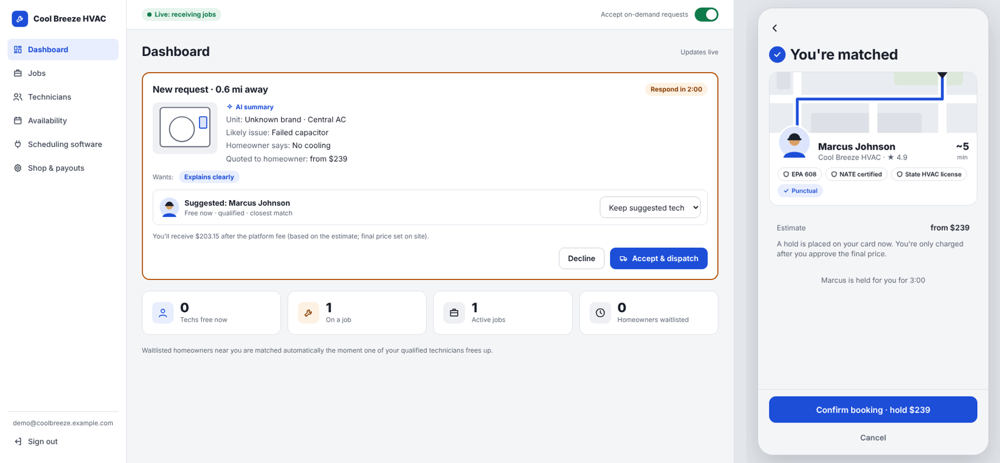

# HVAC Connect



On-demand HVAC service, like Uber for HVAC. Homeowners describe the problem and snap a
photo of their unit. AI identifies the unit and the likely issue, shows a starting price,
and matches them with the closest qualified technician who is free right now, preferring
the soft skills they asked for. If nobody is free, the homeowner joins a live waitlist with
an estimated wait. HVAC shops manage technicians and availability (from ServiceTitan or
Housecall Pro), accept jobs, and get paid through Stripe.

| Part | Tech | Folder |
|---|---|---|
| API + matching engine | Python 3.12, FastAPI, SQLAlchemy 2 (async), Alembic | `backend/` |
| Homeowner app | Expo (React Native), runs on web, iOS and Android | `mobile/` |
| Shop portal | React + Vite (desktop web) | `shop-portal/` |

---

## Run the demo on Windows

### 1. Install the prerequisites (once)

- **Python 3.12 or newer**: https://www.python.org/downloads/ (tick *Add python.exe to PATH*)
- **Node.js 22 LTS or newer**: https://nodejs.org/

No database, Docker or third-party accounts are needed for the demo.

### 2. Set up (once, about 5 minutes)

Open PowerShell in the project folder and run:

```powershell
powershell -ExecutionPolicy Bypass -File scripts\windows\setup.ps1
```

### 3. Start everything

```powershell
powershell -ExecutionPolicy Bypass -File scripts\windows\start-demo.ps1
```

This opens three windows (API, shop portal, homeowner app) and two browser tabs:

| | URL | Sign in with |
|---|---|---|
| Shop portal | http://localhost:5173 | Click **Fill demo login**. The 2-step code fills in automatically |
| Homeowner app | http://localhost:8081 | Click **Use demo homeowner**. The text code fills in automatically |

To stop, close the three PowerShell windows. To wipe demo data between pitches, stop the API
window and run `scripts\windows\reset-demo.ps1`.

> On macOS/Linux, use `./scripts/setup.sh` and `./scripts/start-demo.sh`.

### Troubleshooting

- **"Running scripts is disabled on this system"**: start the command with
  `powershell -ExecutionPolicy Bypass -File ...` exactly as shown above.
- **Windows Firewall prompt on first start**: allow access for Python and Node (private
  networks are enough).
- **"Can't reach the server"** in either app: the API window must be running; check it for
  errors.
- **"Please wait N seconds before requesting a new code"**: sign-in codes can be re-sent every
  30 seconds per phone number. Wait a moment, or use a different number.
- **A port is already in use**: close old demo windows (or restart the computer) and start
  again. The apps expect ports 8000, 5173 and 8081.

---

## VC demo script (about 5 minutes)

Put the two browser windows side by side: **shop portal on the left, homeowner app on the
right.** The homeowner app shows as a phone on a desktop screen.

**1. The homeowner problem (right).**
Use demo homeowner → save the test card (explain that it works like Uber: a hold when you
book, charged after the job) → **Start a request** → tap **No cooling** → **Next** → take or
upload a photo of an HVAC unit → **Analyze my unit**. Show the identified brand, model and
age, the likely issue with confidence, and the low-end estimate, labeled as an estimate.

**2. Matching (right).**
Pick **Explains clearly** → **Find a technician**. The app finds the closest qualified,
available tech with that soft skill, shows their certifications and arrival time, and
reserves them for 3 minutes. Tap **Confirm booking**: the card hold is placed.

**3. The shop side (left).**
The offer appears on the dashboard with a 2-minute countdown, the AI summary, the photo,
the requested soft skills and the shop's payout after fees. Click **Accept & dispatch**.
The homeowner screen updates live. Go to **Jobs**: **Mark en route** → **Arrived on site**
→ enter a final price (e.g. 285) → **Send price to homeowner**.

**4. Approval and payment (right, then left).**
The homeowner approves the final price → in the portal, **Mark complete & charge**. The
homeowner sees the receipt and rates the technician; the portal shows the payout.

**5. The live waitlist (both).**
In the portal, open **Availability** and click **Busy 45m** on every technician. Have the
homeowner start a new request: they land on the **live waitlist** with an estimated wait
and their place in line. Click **Free now** on *Marcus Johnson* (an AC tech). Within a few
seconds the homeowner is matched automatically, without refreshing.

> To impress with real AI: set `HVAC_AI_PROVIDER=anthropic` and your API key in
> `backend\.env`, restart the API, and photograph a real data plate. The model reads the
> brand, model and serial number and estimates the age. In demo mode the analysis is
> rule-based and always reports the same sample unit.

---

## Turning on real services

Everything is configured in `backend/.env` (copy of `.env.example`). Each integration has a
demo stand-in, so you can switch them on one at a time.

| Service | Setting | Notes |
|---|---|---|
| AI photo analysis | `HVAC_AI_PROVIDER=anthropic`, `HVAC_ANTHROPIC_API_KEY` | Claude reads the photo through a strict JSON schema; prices always come from `domain/pricing.py`, never from the model |
| Payments | `HVAC_PAYMENTS_PROVIDER=stripe`, `HVAC_STRIPE_SECRET_KEY`, `HVAC_STRIPE_PUBLISHABLE_KEY`, `HVAC_STRIPE_WEBHOOK_SECRET` | Use test keys first. Enable **Connect** in your Stripe dashboard (shops get Express accounts). Forward webhooks locally with `stripe listen --forward-to localhost:8000/v1/webhooks/payments` |
| Text messages | `HVAC_SMS_PROVIDER=twilio` + Twilio credentials | Sign-in codes and job updates |
| Addresses | `HVAC_GEOCODING_PROVIDER=mapbox`, `HVAC_MAPBOX_TOKEN` | Demo mode places every address near Atlanta |
| Scheduling | Shops connect in the portal (**Scheduling software**) | Credentials are encrypted at rest; availability re-syncs every 5 minutes |

The apps read their API address from `mobile/.env` (`EXPO_PUBLIC_API_URL`) and
`shop-portal/.env` (`VITE_API_URL`). To try the homeowner app on a phone with **Expo Go**,
set `EXPO_PUBLIC_API_URL` to your computer's Wi-Fi IP (e.g. `http://192.168.1.20:8000/v1`),
run `npx expo start` in `mobile/` and scan the QR code. Apple Pay and Google Pay (and real
card entry, if it doesn't open in Expo Go) need a development build
(`npx expo run:android` / `run:ios`).

---

## How it works

### Request lifecycle

```
draft ─► analyzed ─► proposed ──(homeowner confirms, card hold)──► offered ──(shop accepts)──► dispatched
            │            │ expires (3 min) → analyzed                 │ declined / no reply (2 min)
            │            ▼                                            ▼   → offered to next best tech
            └──► waitlisted ◄──────────────── nobody free ────────────┘   → or back to waitlist
dispatched ─► en_route ─► on_site ─► quoted ─► in_progress ─► completed (card charged)
```

Every status change goes through one function (`services/lifecycle.py`), which checks it
against the allowed transitions (`domain/state_machine.py`) and writes an audit event.

### Matching rules (`backend/app/domain/matching.py`)

1. **Hard filters:** technician active; shop live with payouts enabled; homeowner within the
   tech's service radius; qualified for the identified equipment; EPA 608 certified if
   refrigerant work is likely; hasn't already declined this job.
2. **Free right now:** on shift (from ServiceTitan shifts or the tech's working hours), not
   booked, and not on another job in the app.
3. **Soft skills:** if the homeowner requires all of them, techs missing any are dropped.
   Otherwise the closest tech with all requested skills wins, unless they're more than
   10 km farther than the closest tech overall. Ties go to more skills matched, then rating.
4. **Nobody free → live waitlist.** A background worker re-matches the queue in arrival
   order every 5 seconds. The wait estimate (`domain/waitlist.py`) merges each eligible
   tech's next free time, drive time and the people ahead in line.

Two homeowners can't grab the same technician: the tech's row is locked during
reservation (on Postgres), and requests use optimistic version checks so the API and the
worker can't overwrite each other.

### Payments (Uber-style, Stripe Connect)

- Sign-up saves a card with a **SetupIntent**; nothing is charged.
- Confirming a booking places a **hold** for the estimate (manual-capture PaymentIntent)
  routed to the shop's Connect account, with the platform fee attached.
- If the approved final price is higher than the hold, the hold is replaced with one for the
  final amount; **capture** happens when the shop marks the job complete.
- Declines, cancellations and re-matches release holds; uncaptured holds also expire on
  their own. Shops pick daily, weekly or manual payouts.

### Security

- Homeowners sign in with an SMS code: only a keyed hash of the code is stored, with an
  attempt limit, a resend cooldown and an hourly cap.
- Shop users need a password (Argon2) **and** a mandatory authenticator-app code (TOTP).
- Short-lived access tokens; rotating refresh tokens stored hashed. Reuse of an old refresh
  token ends every session in that family.
- Scheduling credentials and TOTP secrets are encrypted at rest (Fernet).
- Shops see a job's photos and AI summary before accepting, but not the homeowner's
  address or phone until dispatch. Homeowners can only read their own requests.
- Photos are type-checked from their bytes, size-limited, and served through short-lived
  signed URLs.
- Production startup refuses to run with demo secrets or demo providers.

### Code map

```
backend/app/
  domain/        Pure business rules, no I/O: matching, waitlist, availability, pricing, states
  services/      Use cases: auth, requests, matching, jobs, payments, shops, availability sync
  integrations/  Adapters behind interfaces: AI (Claude / fake), payments (Stripe / fake),
                 SMS (Twilio / console), geocoding (Mapbox / fake), scheduling (ServiceTitan,
                 Housecall Pro), photo storage
  api/           HTTP routes, auth dependencies, response shaping (privacy rules live here)
  models/        Database tables          worker.py  Background loop
  container.py   Wires adapters from settings in one place (tests swap in fakes here)
mobile/app/      Screens (file-based routes); mobile/components, mobile/lib for shared code
shop-portal/src/ pages/, components/, lib/
```

---

## Development

```powershell
cd backend
.\.venv\Scripts\python.exe -m pytest -q          # 41 tests: domain rules + full API flows
.\.venv\Scripts\python.exe -m ruff check app tests
.\.venv\Scripts\python.exe -m mypy app
.\.venv\Scripts\python.exe -m uvicorn app.main:app --reload   # API docs at http://localhost:8000/docs
```

Tests use a temporary SQLite database. Set `HVAC_TEST_DATABASE_URL` to a Postgres URL to
run the same suite against Postgres, as CI does (`.github/workflows/ci.yml`).

Changing a model: `python -m alembic revision --autogenerate -m "describe change"`, review
the file, then `python -m app.cli migrate`.

Type-checks for the apps: `npx tsc --noEmit` in `mobile/` and `shop-portal/`.

### Production

`docker compose up --build` runs Postgres, the API and the worker as separate processes,
which is how production should run (`HVAC_RUN_WORKER_IN_PROCESS=false`). Before going live:
set `HVAC_ENVIRONMENT=prod` with real secrets and providers, store photos in S3 or GCS
(implement `FileStorage`), put the API behind HTTPS with rate limiting at the gateway, and
host the portal's `dist/` and the Expo web build on a CDN.

---

## Known gaps / next steps

- **ServiceTitan and Housecall Pro adapters** follow their published APIs but haven't been
  run against live accounts. Verify field names in a developer sandbox; all mapping is
  isolated in `integrations/scheduling/`. Writing accepted jobs back into their calendars
  is stored as a setting but not implemented yet.
- **Business verification** for shops was removed for now, as requested. Payouts still
  require Stripe's identity and bank verification.
- **Apple / Google sign-in, passkeys and push notifications** aren't built yet. Updates
  reach homeowners through live screen refresh and text messages.
- **Maps are illustrative.** There's no live GPS tracking of technicians, and distances are
  straight-line. Add a technician app (or the shop's GPS feed) and a routing API next.
- **Not yet built:** tips, refunds and disputes, an internal admin console, and message
  threads between homeowner and tech (the app uses call and SMS links).
- **Card re-authorization** for a higher quote can need the homeowner to confirm in the app
  (3-D Secure); that error is surfaced, but there's no in-app confirmation flow yet.
