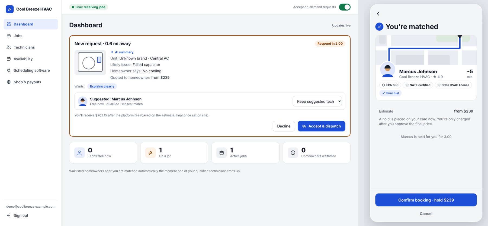

# HVAC Connect



On-demand HVAC service, like Uber for HVAC. Homeowners describe the problem and snap a
photo of their unit. AI identifies the unit and the likely issue, shows a starting price,
and matches them with the closest qualified technician who is free right now, preferring
the soft skills they asked for. If nobody is free, the homeowner joins a live waitlist with
an estimated wait. HVAC shops manage technicians and availability (from ServiceTitan or
Housecall Pro later), accept jobs that land on each technician's calendar, and get paid
through Stripe.

| Part | Tech | Folder |
|---|---|---|
| API + matching engine | Python 3.12, FastAPI, SQLAlchemy 2 (async), Alembic | `backend/` |
| Homeowner app | Expo (React Native), runs on web, iOS and Android | `mobile/` |
| Shop portal | React + Vite (desktop web) | `shop-portal/` |

---

## Run it on Windows

### 1. Install the prerequisites (once)

- **Python 3.12 or newer**: https://www.python.org/downloads/ (tick *Add python.exe to PATH*)
- **Node.js 22 LTS or newer**: https://nodejs.org/
- An **authenticator app** on your phone (Google Authenticator, Microsoft Authenticator,
  1Password...). Every shop account requires one.

### 2. Set up (once, about 5 minutes)

Open PowerShell in the project folder and run:

```powershell
powershell -ExecutionPolicy Bypass -File scripts\windows\setup.ps1
```

### 3. Add your keys (any time)

Open `backend\.env` (created by setup from `.env.example`) and fill in the services you
have. Each one switches on when its keys are present; nothing is faked when they're missing.
See [Keys](#keys) below. Restart the API window after editing.

### 4. Start everything

```powershell
powershell -ExecutionPolicy Bypass -File scripts\windows\start-demo.ps1
```

It updates the database, prints which services are ON/OFF, then opens three windows (API,
shop portal, homeowner app) and two browser tabs:

| | URL | |
|---|---|---|
| Shop portal | http://localhost:5173 | **Create account** with Google or email + password, then scan the QR code with your authenticator app |
| Homeowner app | http://localhost:8081 | **Continue with Google** or with a mobile number |

To stop, close the three PowerShell windows. To delete **all** accounts and requests and
start over, close the API window and run `scripts\windows\reset-database.ps1`.

> On macOS/Linux, use `./scripts/setup.sh` and `./scripts/start-demo.sh`.

### Creating test accounts

There is no demo data. Create real accounts with real addresses:

1. **Shop owner (left window):** Create account → turn on 2-step verification with your
   authenticator app → **Shop & payouts**: enter the shop's real street address (with city,
   state and ZIP) → **Technicians**: add at least one tech with working hours that include
   *now* → flip **Accept on-demand requests** at the top right.
2. **Homeowner (right window):** Continue with Google or a mobile number → enter a name and a
   real home address near the shop (within the tech's service radius, 25 km by default).
   Google users also confirm a mobile number with a texted code.
3. Start a request and book. The job appears in the shop's **Jobs** and on the tech's
   calendar (**Availability**).

Addresses are looked up with the free US Census geocoder, so made-up addresses are rejected.
For more homeowners, sign out (**Account → Sign out**) and use another number or Google
account. Until Twilio is connected, codes are shown on screen (**TEST MODE**), so any US
number works. With a Twilio *trial* account, codes only reach numbers you've verified in
Twilio.

### Troubleshooting

- **"Running scripts is disabled on this system"**: start the command with
  `powershell -ExecutionPolicy Bypass -File ...` exactly as shown above.
- **Windows Firewall prompt on first start**: allow access for Python and Node.
- **"Can't reach the server"**: the API window must be running; check it for errors.
- **"We couldn't find that address"**: include the house number, street, city, state and
  ZIP, e.g. `191 Peachtree St NE, Atlanta, GA 30303`.
- **"No technician available" right away**: the shop must be live, the tech active and
  on shift now (working hours), and the home inside the tech's service radius.
- **Google button doesn't appear**: `HVAC_GOOGLE_CLIENT_IDS` isn't set, or the origin
  (`http://localhost:8081` / `http://localhost:5173`) isn't in the OAuth client's
  *Authorized JavaScript origins*.
- **A port is already in use**: close old windows and start again. The apps use ports
  8000, 5173 and 8081.

---

## Keys

All settings live in `backend/.env`. Run `.venv\Scripts\python.exe -m app.cli check` in
`backend\` to see what's on.

| Service | What it powers | Without it | Settings |
|---|---|---|---|
| **Google** (free) | "Continue with Google" for homeowners and shops | Only phone (homeowners) and email + password (shops) | `HVAC_GOOGLE_CLIENT_IDS` |
| **Twilio Verify** | Texted sign-in codes | Development only: the code is shown on screen | `HVAC_TWILIO_ACCOUNT_SID`, `HVAC_TWILIO_AUTH_TOKEN`, `HVAC_TWILIO_VERIFY_SERVICE_SID` |
| **Twilio Messaging** | Job-update texts (matched, on the way, done) | Updates show in the app only | `HVAC_TWILIO_FROM_NUMBER` or `HVAC_TWILIO_MESSAGING_SERVICE_SID` |
| **Anthropic** | "Snap your unit": Claude reads the label and looks for visible problems | Photos go to the tech; no automatic diagnosis | `HVAC_ANTHROPIC_API_KEY` |
| **Stripe** | Card on file, hold at booking, charge at completion, shop payouts (Connect) | No card needed; the homeowner pays the shop directly | `HVAC_STRIPE_SECRET_KEY`, `HVAC_STRIPE_PUBLISHABLE_KEY`, `HVAC_STRIPE_WEBHOOK_SECRET` |

**Google:** Google Cloud Console → *APIs & Services* → *OAuth consent screen* (External,
add your email as a test user) → *Credentials* → *Create credentials* → *OAuth client ID* →
*Web application*. Add `http://localhost:8081` and `http://localhost:5173` under *Authorized
JavaScript origins* (add your real domains later). Copy the client ID.

**Twilio:** create an account → *Verify* → *Services* → *Create* → copy the Service SID
(`VA…`), plus your Account SID and Auth Token from the console home page. Only US (+1)
numbers can request codes (blocks SMS-pumping fraud; change with
`HVAC_SMS_ALLOWED_COUNTRY_CODES`). Sending job-update texts from a US number requires A2P 10DLC
registration in Twilio.

**Anthropic:** console.anthropic.com → *API keys*. The model is set with
`HVAC_ANTHROPIC_MODEL` (default `claude-sonnet-5-5`).

**Stripe:** dashboard.stripe.com → *Developers* → *API keys* (start with test keys) and turn
on **Connect** (shops get Express accounts). For webhooks locally:
`stripe listen --forward-to localhost:8000/v1/webhooks/payments` and put the `whsec_…` it
prints in `HVAC_STRIPE_WEBHOOK_SECRET`. Test card: `4242 4242 4242 4242`, any future date
and CVC. Payments are **cards only** (no Apple Pay / Google Pay).

The apps read the API address from `mobile/.env` (`EXPO_PUBLIC_API_URL`) and
`shop-portal/.env` (`VITE_API_URL`).

---

## VC demo script (about 5 minutes)

Before the meeting, create one shop with two or three technicians (working hours covering
the meeting time) and one homeowner, with real addresses a few miles apart. Put the shop
portal on the left and the homeowner app on the right.

1. **Homeowner (right):** **Start a request** → **No cooling** → **Next** → upload a photo of
   a real unit's label → **Analyze my unit**. With the Anthropic key set, Claude reads the
   brand, model, serial, manufacture year (age), refrigerant and tonnage, and lists anything
   visibly wrong. Show the low-end estimate, labeled as an estimate.
2. **Matching (right):** pick a soft skill → **Find a technician** → the closest qualified,
   available tech is reserved for 3 minutes → **Confirm booking**.
3. **Shop (left):** the offer appears with a countdown. **Availability** already shows the job
   on the tech's calendar as *Pending*. **Accept & dispatch**: the calendar entry fills in
   with the customer's name and address, and the tech can subscribe to it from their phone
   (**Calendar link**).
4. **Job (both):** **Mark en route** → **Arrived on site** → enter a price → the homeowner
   approves → **Mark complete**. The homeowner rates the tech.
5. **Live waitlist (both):** mark every tech **Busy 45m**, start another request → the
   homeowner joins the live waitlist with an estimated wait → click **Free now** on a tech →
   they're matched within seconds.

---

## How it works

### Request lifecycle

```
draft ─► analyzed ─► proposed ──(homeowner confirms, card hold)──► offered ──(shop accepts)──► dispatched
            │            │ expires (3 min) → analyzed                 │ declined / no reply (2 min)
            │            ▼                                            ▼   → offered to next best tech
            └──► waitlisted ◄──────────────── nobody free ────────────┘   → or back to waitlist
dispatched ─► en_route ─► on_site ─► quoted ─► in_progress ─► completed (card charged, if Stripe is on)
```

Every status change goes through one function (`services/lifecycle.py`), which checks it
against the allowed transitions (`domain/state_machine.py`) and writes an audit event.

### Matching rules (`backend/app/domain/matching.py`)

1. **Hard filters:** technician active; shop live (with payouts enabled when Stripe is on); homeowner within the
   tech's service radius; qualified for the identified equipment; EPA 608 certified if
   refrigerant work is likely; hasn't already declined this job.
2. **Free right now:** on shift (the tech's working hours), not marked busy, and not on
   another job in the app.
3. **Soft skills:** if the homeowner requires all of them, techs missing any are dropped.
   Otherwise the closest tech with all requested skills wins, unless they're more than
   10 km farther than the closest tech overall. Ties go to more skills matched, then rating.
4. **Nobody free → live waitlist.** A background worker re-matches the queue in arrival
   order every 5 seconds. The wait estimate (`domain/waitlist.py`) merges each eligible
   tech's next free time, drive time and the people ahead in line.

Two homeowners can't grab the same technician: the tech's row is locked during
reservation (on Postgres), and requests use optimistic version checks so the API and the
worker can't overwrite each other.

### Technician calendars

When the homeowner confirms, the job is put on the assigned tech's calendar as *Pending*
(no customer details yet). When the shop accepts, the entry gets the customer's name,
phone, address and the likely issue. Declines, expiries and cancellations remove it; a
completed job is trimmed to its finish time. The entries show on the **Availability**
board, count as busy time for matching, and are published to each tech's private
calendar feed (`.ics`) that they can subscribe to from Google Calendar, Apple Calendar or
Outlook. Google Calendar fetches feeds from Google's servers, so it needs the API on a
public URL; Apple Calendar and Outlook on the same computer work with localhost.

ServiceTitan and Housecall Pro sync is optional and shows as *Coming soon* until API access
is granted (`HVAC_SCHEDULING_INTEGRATIONS_ENABLED`). The adapters are in
`integrations/scheduling/`.

### Snap your unit (Claude)

Photos are auto-rotated and resized to 1568 px before being sent. A forced tool call makes
Claude answer in a strict JSON schema: brand, model and serial (only if legible),
manufacture year (from a printed date or a serial-number format it recognizes), equipment
type, tonnage, refrigerant, SEER, voltage, fuel, visible problems, the likely issue category
with confidence, a safety warning, and retake advice if the label can't be read. The server
validates every field and computes age from the year. **Prices never come from the model**:
they come from the price book in `domain/pricing.py`.

### Payments (Uber-style, Stripe Connect)

- Sign-up saves a card with a **SetupIntent** (cards only); nothing is charged.
- Confirming a booking places a **hold** for the estimate (manual-capture PaymentIntent)
  routed to the shop's Connect account, with the platform fee attached.
- If the approved final price is higher than the hold, the hold is replaced with one for the
  final amount; **capture** happens when the shop marks the job complete.
- Declines, cancellations and re-matches release holds; uncaptured holds also expire on
  their own. Shops pick daily, weekly or manual payouts.
- Without Stripe keys, payments are off: no card is asked for, nothing is held or charged,
  and shops can go live without payouts.

### Security

- **Phone codes** are generated, sent and checked by Twilio Verify. We add a resend cooldown,
  an hourly cap per number, an attempt limit, a per-IP limit and a US-only allowlist.
  (Without Twilio, in development only, codes are generated locally and only a keyed hash
  is stored.)
- **Google sign-in** verifies the ID token's signature against Google's published keys, the
  issuer, our client ID as audience, expiry and a verified email. Each attempt carries a
  single-use nonce issued by the API, so a captured token can't be replayed. Google users
  must also verify a phone number.
- **Shop users** sign in with Google or a password (Argon2) **and** always a mandatory
  authenticator-app code (TOTP), with a per-account guess limit.
- Short-lived access tokens; rotating refresh tokens stored hashed. Reuse of an old refresh
  token ends every session in that family.
- Scheduling credentials and TOTP secrets are encrypted at rest (Fernet).
- Shops see a job's photos and AI summary before accepting, but not the homeowner's
  address or phone until dispatch. Homeowners can only read their own requests.
- Photos are type-checked from their bytes, size-limited, and served through short-lived
  signed URLs.
- Security headers on every response; production startup refuses to run with dev secrets,
  test doubles or without Twilio.

### Code map

```
backend/app/
  domain/        Pure business rules, no I/O: matching, waitlist, availability, pricing, states
  services/      Use cases: auth, requests, matching, jobs, payments, shops, availability sync
  integrations/  Adapters behind interfaces: Claude, Stripe, Twilio Verify + Messaging,
                 Google sign-in, geocoding (US Census / Google / Mapbox), scheduling
                 (ServiceTitan, Housecall Pro), photo storage. *fake* modules are test-only.
  api/           HTTP routes, auth dependencies, response shaping (privacy rules live here)
  models/        Database tables          worker.py  Background loop
  container.py   Wires adapters from settings in one place; a service without keys is None (off)
mobile/app/      Screens (file-based routes); mobile/components, mobile/lib for shared code
shop-portal/src/ pages/, components/, lib/
```

---

## Development

```powershell
cd backend
.\.venv\Scripts\python.exe -m pip install -e ".[dev]"   # test + lint tools (once)
.\.venv\Scripts\python.exe -m pytest -q          # 58 tests: rules, sign-in, calendars, full flows
.\.venv\Scripts\python.exe -m ruff check app tests
.\.venv\Scripts\python.exe -m mypy app
.\.venv\Scripts\python.exe -m uvicorn app.main:app --reload   # API docs at http://localhost:8000/docs
```

Tests use a temporary SQLite database. Set `HVAC_TEST_DATABASE_URL` to a Postgres URL to
run the same suite against Postgres, as CI does (`.github/workflows/ci.yml`).

Changing a model: `python -m alembic revision --autogenerate -m "describe change"`, review
the file, then `python -m app.cli migrate`.

Type-checks for the apps: `npx tsc --noEmit` in `mobile/` and `shop-portal/`.

### Production

`docker compose up --build` runs Postgres, the API and the worker as separate processes,
which is how production should run (`HVAC_RUN_WORKER_IN_PROCESS=false`). Before going live:
set `HVAC_ENVIRONMENT=prod` with real secrets and providers, store photos in S3 or GCS
(implement `FileStorage`), put the API behind HTTPS with rate limiting at the gateway, and
host the portal's `dist/` and the Expo web build on a CDN.

---

## Known gaps / next steps

- **ServiceTitan and Housecall Pro** show as *Coming soon*. The adapters follow their
  published APIs but haven't been run against live accounts.
- **Outside services were tested against stand-ins**, not live accounts: Google sign-in is
  tested with real signed tokens and key sets, Twilio Verify and the Census geocoder against
  their documented responses, and the Claude prompt/parser with sample outputs. Try each one
  with your keys before a demo.
- **Business verification** for shops was removed for now, as requested. Payouts still
  require Stripe's identity and bank verification.
- **Google sign-in on the iOS/Android apps** needs native Google Sign-In with iOS and
  Android client IDs; until then the phone apps offer phone sign-in. Push notifications
  aren't built yet; updates reach homeowners through live screen refresh and texts.
- **Scheduled (not ASAP) bookings** still match to whoever is free now; picking a time slot
  for "this week" requests isn't built yet.
- **Maps are illustrative.** There's no live GPS tracking of technicians, and distances are
  straight-line. Add a technician app (or the shop's GPS feed) and a routing API next.
- **Not yet built:** tips, refunds and disputes, an internal admin console, and message
  threads between homeowner and tech (the app uses call and SMS links).
- **Card re-authorization** for a higher quote can need the homeowner to confirm in the app
  (3-D Secure); that error is surfaced, but there's no in-app confirmation flow yet.
